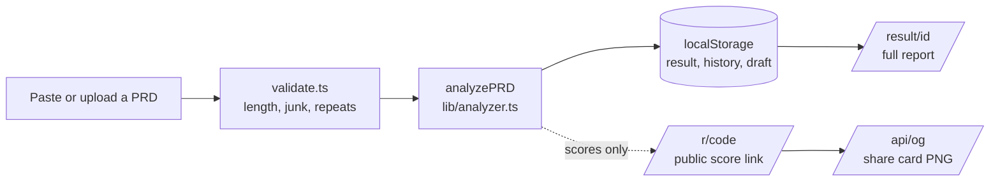

# Architecture

PRD Doctor is a Next.js app with no database and no server-side analysis. The scoring engine is a plain TypeScript module that runs in the visitor's browser. The server only renders pages and images.

## Overview



1. **Input.** Text is pasted (rich text from Google Docs, Notion and Confluence is converted by `lib/paste.ts`) or read from a PDF, Word, Markdown or text file by `lib/files.ts`. Parsers for PDF (`unpdf`) and Word (`mammoth`) are loaded on demand.
2. **Validation.** `lib/validate.ts` rejects input that is too short, too long, code-like or mostly repeated, with a message that says what to fix.
3. **Analysis.** `analyzePRD()` in `lib/analyzer.ts` makes no network calls and uses no random source in scoring, so the same text always produces the same score, quotes and rewrite. (The result record also gets a random id and a timestamp, which never affect the scores.)
4. **Storage.** The result, including the PRD text (so the user can edit and re-score), is written to `localStorage`. Nothing is sent to a server.
5. **Report.** `/result/[id]` reads the result from `localStorage` and renders the report. The route is a thin server shell that only sets page metadata.
6. **Sharing.** Only scores leave the browser, and only when the user shares a link (see below).

## Module map

| Path | Responsibility |
|---|---|
| `app/page.tsx` | Editor, file drop, examples, history list, analysis trigger |
| `app/result/[id]/page.tsx` | Server shell for a private report; `generateMetadata()` sets the preview image |
| `app/r/[code]/page.tsx` | Public score page decoded from a short code |
| `app/api/og/route.tsx` | 1200×630 share card (`next/og`), also the "Download card" file |
| `app/how-scoring-works/` | Rubric page generated from the live code |
| `app/opengraph-image.tsx`, `icon.svg`, `apple-icon.tsx` | Link preview and icons |
| `lib/analyzer.ts` | Rubrics, section parsing, scoring, quote selection, rewrite scaffold, share payload encoding |
| `lib/examples.ts` | Three fictional example PRDs (rough, decent, strong) |
| `lib/storage.ts` | `localStorage` access with an in-memory fallback |
| `lib/files.ts` | PDF, Word, Markdown and text reading, entirely client-side |
| `lib/paste.ts` | Rich-text paste to Markdown-like text |
| `lib/validate.ts` | Input checks |
| `lib/report.ts` | Markdown report and per-fix export |
| `lib/analytics.ts` | PostHog wrapper, a no-op without a key |
| `lib/site.ts` | Site name, URL and author links |
| `components/result-view.tsx` | Hero, radar, bars, fixes, rewrite, share controls |
| `scripts/` | `score-check`, `paste-check`, `fuzz`, `gen-docs`, `axe-snippet` |

## The analyzer

`lib/analyzer.ts` is organised in four stages.

1. **Normalise and split.** Clean the text, drop front matter (Version, Status, Owner and similar), and split it into sections. A line counts as a heading if it is a Markdown heading, a numbered heading, a bold label, a `Label:` line, or a short standalone line that names a known category.
2. **Assign credit.** Each sentence is tested against the signals of every category. A sentence can pay into at most four categories, and the category of the section it sits in is considered first. Plans, product descriptions and placeholder lines are filtered out before credit is given (see [scoring.md](scoring.md)).
3. **Score.** A category's score is the sum of its found signals, plus bonuses and minus penalties, clamped to 0 to 100. The overall score is the weighted sum of the twelve categories.
4. **Quote and explain.** For each category the engine picks a sentence from the user's own text to point at, preferring a sentence from the category's own section and avoiding the same quote twice. If nothing relevant exists it says so. The suggested rewrite is a scaffold built only from those quotes and fixed text.

The output is only ever sentences copied from the input, fixed rubric text, and `[bracketed blanks]`.

## Sharing without a database

A shared score is a small payload of scores, never text:

```json
{ "v": 1, "o": 83, "c": [85, 70, 75, 80, 100, 75, 100, 100, 100, 85, 50, 70] }
```

| Form | Where it is used | Encoding |
|---|---|---|
| Long link `?s=` | Share card image URL, before and after link | base64url of the JSON above |
| Previous scores `?p=` | The "before" side of a progress card | base64url of `{ o, c }` |
| Short code `/r/<code>` | The public link people paste into posts | 13 bytes (the overall score and 12 category scores) as base64url, 18 characters |

`decodePayload` and `decodeShort` validate the version, the length (exactly 12 category scores) and that every value is a number from 0 to 100, and return `null` otherwise. The routes show a friendly "damaged link" page or answer `400`.

Because the payload has a fixed shape, **adding or removing a category is a breaking change for existing links.** Bump `v` and keep a decoder for the old version if old links need to keep working.

The share card is fully determined by its URL, so `/api/og` sends `Cache-Control: public, max-age=86400, s-maxage=604800, stale-while-revalidate=86400` and a traffic spike is served from the CDN.

## Browser storage

| Key | Contents |
|---|---|
| `prd-doctor:result:<id>` | A full analysis result, including the PRD text |
| `prd-doctor:history` | Index of recent analyses (title, date, scores) |
| `prd-doctor:draft` | The text in the editor, so a refresh does not lose it |
| `prd-doctor:done:<id>` | Fixes marked as addressed |
| `prd-doctor:feedback:<id>` | Whether the "does this score feel right?" prompt was answered |
| `prd-doctor:theme` | Light or dark preference |

If `localStorage` is blocked or full, results are kept in memory for the session and the app keeps working.

## Security headers and crawling

`next.config.ts` sets `X-Content-Type-Options`, `X-Frame-Options: SAMEORIGIN`, `Referrer-Policy: strict-origin-when-cross-origin` and a `Permissions-Policy` that disables camera, microphone and geolocation. `robots.txt` disallows `/result/` and `/api/`, so private report URLs are not indexed.

## Testing strategy

| Script | What it protects |
|---|---|
| `npm run check` | Scoring regression ranges for the fictional examples, hand-written samples (including messy ones) and any private calibration set, plus the language check |
| `npm run paste` | The paste converter against Google Docs, Notion and Confluence-shaped HTML, with regression cases for two bugs found by hand |
| `npm run fuzz` | 20 hostile inputs: no crashes, scores stay within 0 to 100, bounded runtime |
| `npm run docs:check` | `docs/scoring.md` matches the live rubric |
| `scripts/axe-snippet.js` | Manual accessibility audit with axe-core (needs a real browser) |

CI runs type checking, lint, `npm test` and a production build on every push and pull request.

## Decisions and tradeoffs

- **Heuristics over an LLM.** Free, instant, private, explainable and testable, and it cannot invent facts. The cost is that it detects the presence of structure, not its quality, patterns are English only, and a PRD written to the rubric can score well.
- **Stateless sharing over a database.** No infrastructure and nothing to leak. The cost is that a public link cannot show the full report, and anyone can hand-craft a link that shows a fake score. A shared score is a self-reported signal, not a certificate.
- **Results in `localStorage`.** Clearing the browser loses them. That is acceptable for an anonymous tool and is the price of keeping documents off the server.
- **Hand-rolled radar and bars** instead of a chart library: about 40 lines and no dependency.

## Extending it

- **A new example PRD:** add it to `lib/examples.ts` with the score range it should produce, then run `npm run check`.
- **A new signal in a category:** add it to that category's `signals` in `RUBRICS`, run `npm run check` and `npm run docs`, and commit the regenerated `docs/scoring.md`.
- **A new category:** add a `RUBRICS` entry and a matching `SECTION_RE` entry, rebalance the weights so they add up to 100, and read the note on share links above before changing the number of categories.
